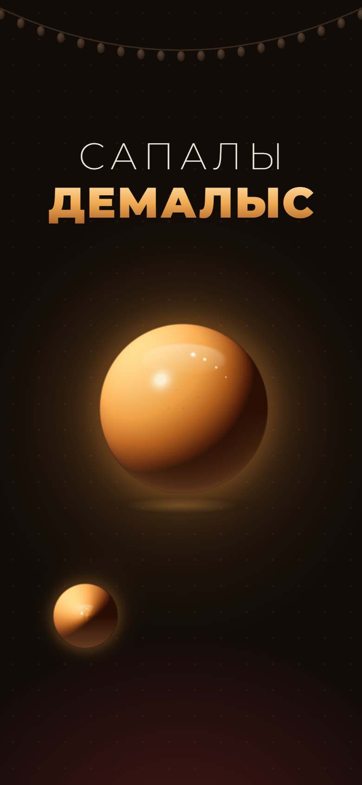
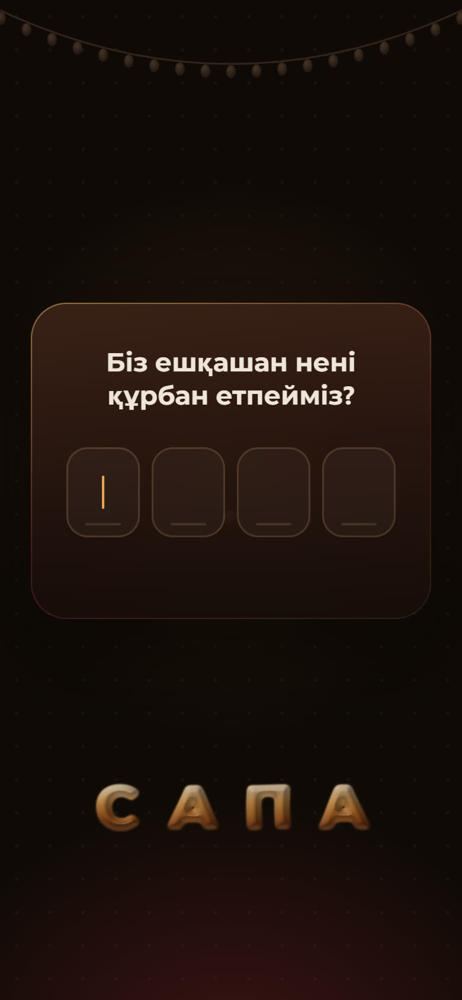
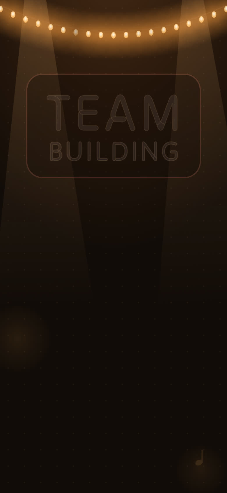
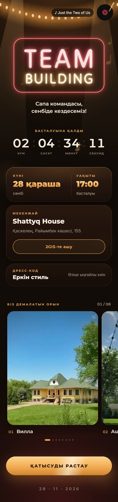
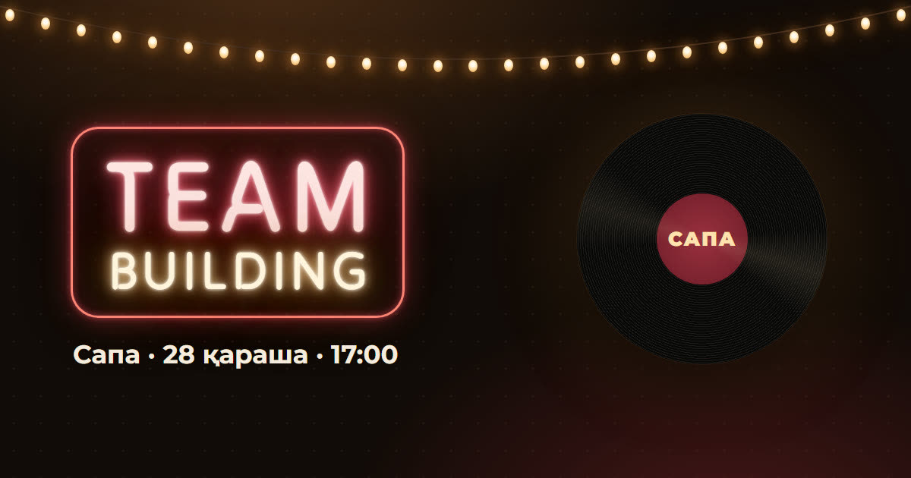

# Сапа · Тимбилдинг 28.11 — дизайн-бриф (v2 «Виски»)

Бриф для доработки визуала в Claude Design. Описывает текущую версию сайта-приглашения:
экраны, тексты, токены, компоненты, анимации и технические ограничения, которые нужно
сохранить, чтобы новый дизайн можно было перенести обратно в код.

- Живая версия: https://dan1eloff.github.io/sapa-teambuilding/
- Скриншоты текущей версии: `docs/screens/*.jpg` (390×844, ретина)
- Исходник макета из Claude Design: `docs/design/sapa-invite-v2.dc.html`

---

## 1. Контекст

| | |
|---|---|
| Что | Интерактивное приглашение отдела **Сапа** на тимбилдинг |
| Кто открывает | Сотрудники отдела (Сапа — отдел контроля качества в JUZ40) |
| Где | **Телефон, встроенный браузер Telegram** (iOS и Android). ПК — редко |
| Экран | 360–430 px по ширине, вертикально. Только тёмная тема |
| Язык интерфейса | **Казахский** (подписи в брифе — с переводом на русский) |
| Событие | Сб, 28.11.2026, 17:00 · Shattyq House, Қаскелең, Райымбек көшесі, 155 · дресс-код «Еркін стиль» |
| Настроение | Тёплый вечер, джаз-клуб, виски и янтарь, гирлянды («сапа» = «качество») |
| Музыка | «Just the Two of Us» (Grover Washington Jr.), включается после кода |

Чего **не делаем**: лейблы вроде «SAPA TEAM» над заголовком, плашки вроде «ШАҚЫРУ АШЫЛДЫ»,
текстовые подсказки «нажми 4 раза», иконка замка, ромб как кнопка, летающие по фону буквы.

---

## 2. Флоу и экраны

### Экран 1. Вход: янтарная сфера
 

- Гирлянда сверху **выключена** (тёмные стеклянные лампы на проводе).
- Заголовок: **САПАЛЫ** (Montserrat 200, разрядка .16em) / **ДЕМАЛЫС** (900, золотой градиент).
- По центру **жидкая янтарная сфера** (WebGL): глянец, мягкий верхний блик, 4 отражения ламп,
  дышащее свечение вокруг, тень и янтарный отблеск на «полу». Поверхность живая, сама слегка пульсирует.
- Каждый тап: сфера вздрагивает → отрывается капля → стекает вниз → **перетекает в букву**.
  За 4 тапа получается **С А П А** (янтарный гель с вертикальным градиентом). Сфера каждый раз теряет 13% размера, после 4-й буквы растворяется.

### Экран 2. Код
  

- Карточка на 46% высоты, рамка-градиент (янтарь → бордо → янтарь), плотный тёмно-коричневый фон.
- Вопрос: **«Біз ешқашан нені құрбан етпейміз?»** («Чем мы никогда не жертвуем?»). Ответ — САПА.
- 4 ячейки 62×76 с подчёркиванием: активная — янтарная рамка, свечение, мигающий курсор.
- Неверно: ячейки красные, карточка трясётся, «Қате, тағы байқап көр», через 0.75 с очистка.
- Верно: ячейки заливаются золотом.
- Гелевые буквы САПА плавно съезжают вниз (44 px, 112 px от низа) и становятся полупрозрачными (40%). Гирлянда темнеет.

### Экран 3. Джаз-клуб открывается (приглашение)
  

| t, с | Что происходит |
|---|---|
| 0.00 | Экран кода растворяется |
| 0.25 | Щелчок рубильника, стартует музыка (нарастание 3 с), лампы загораются слева направо по 45 мс с мерцанием |
| 0.90 | Плавно включаются два тёплых прожектора, медленно качаются (±6°) |
| 1.35 | Загорается **рамка-трубка** вывески (красный неон) |
| 1.75 | **TEAM** — розово-красный неон, с мерцанием |
| 2.20 | **BUILDING** — тёплый золотой неон, с искрами |
| 2.50 | Подзаголовок, отсчёт и блоки поднимаются снизу; всплывают янтарные ноты |
| 2.90 | Справа сверху появляется плеер: «♪ Just the Two of Us» + пластинка с бордовым ярлыком |

Дальше: лампы и боке пульсируют **в ритм баса**, неон и рамка иногда «моргают».
При прокрутке плашка с названием трека прячется, пластинка остаётся (тап — пауза, игла поднимается).

Блоки сверху вниз:
1. Неон в рамке **TEAM / BUILDING** + «Сапалы отбасы, сенбіде кездесеміз!»
2. Отсчёт без карточки: «БАСТАЛУЫНА ҚАЛДЫ», цифры 40 px через двоеточия, подписи КҮН · САҒАТ · МИНУТ · СЕКУНД
3. Карточки с разной иерархией:
   - **главная** — КҮНІ / УАҚЫТЫ в две колонки, значения 27 px золотым градиентом, рамка-градиент, янтарный отсвет сверху;
   - **адрес** — Shattyq House 22 px, адрес, кнопка-обводка «2GIS-те ашу» на всю ширину;
   - **дресс-код** — компактная строка: «Еркін стиль» слева, «Өзіңе ыңғайлы киін» справа.
4. Галерея «БІЗ ДЕМАЛАТЫН ОРЫН»: фото 4:5 шириной 300 px, подпись **под** фото («01 Вилла»), счётчик 01/08, точки
5. **«ҚАТЫСУДЫ РАСТАУ»** — кнопка, залитая золотом, с бегущим бликом
6. Подвал «28 · 11 · 2026»

### Экран 4. Финал

- По «Подтвердить»: страница «влетает» в кнопку, по центру слово «САПА» взрывается в размытие, конфетти (янтарь, крем, бордо).
- Большая пластинка 260 px с тонармом и бордовым ярлыком «28.11 / 17:00». Она же кнопка звука.
- **СЕНІ КҮТЕМІЗ!** одной строкой, карточка с датой и адресом, «2GIS-те ашу», «Басына қайту».

### Превью ссылки в Telegram (1200×630)

---

## 3. Дизайн-токены «Виски»

### Цвета
| Токен | Значение | Где |
|---|---|---|
| `--bg` | `#120b08` | фон (на коде `#100a07`) |
| `--ink` | `#f5ebde` | основной текст |
| `--muted` | `#ae9886` | вторичный текст |
| `--faint` | `#8f7867` | подвал |
| `--label` | `#eaa75e` | лейблы-капсы |
| `--gold` | `#f2ab55` | акцент, лампы, кнопки |
| `--gold-hi` | `#ffe2ae` | светлый золотой |
| `--gold-deep` | `#b0632a` | низ золотого градиента |
| `--wine` | `#8c2a38` | ярлык пластинки (финал: `#9a3040 → #6e1c28`) |
| неон-рамка | `#ff8a7a` / `#e0485c` / `#d6455a` | трубка вокруг вывески |
| ошибка | `#ff8f7a` / `#ffb4a5` | рамка / текст |

Градиенты:
- золотой текст — `linear-gradient(180deg, #ffe2ae 0%, #f2ab55 50%, #b0632a 100%)`;
- золотая кнопка — `linear-gradient(180deg, #ffd38c 0%, #f2ab55 55%, #d2852f 100%)`, текст `#2a1209`;
- сфера — `#fff2d6 → #ffd086 → #f0a046 → #b55e1e → #58210b → #290d05` (свет сверху слева);
- буквы-гель — `#fff2d6 → #f2ab55 → #b55e1e → #58210b` сверху вниз;
- фон — янтарное пятно сверху/у сферы, бордовое снизу (`rgba(120,32,40,.4–.5)`), сетка точек 28 px.

### Шрифты
| Роль | Шрифт | Важно |
|---|---|---|
| Заголовки, цифры, лейблы | **Montserrat** 200–900 | Обязательно с казахскими буквами Ә Ғ Қ Ң Ө Ұ Ү Һ І. Unbounded и Manrope **не подходят** |
| Неоновая вывеска | **Tilt Neon** | Только латиница (TEAM BUILDING) |
| Текст | **Inter** 400–700 | |

### Формы
- Радиусы: карточки 28, окно кода 30, ячейки 18, фото 22, кнопки — пилюли, рамка неона 26.
- Карточка: `linear-gradient(180deg, rgba(52,28,20,.72), rgba(24,13,10,.72))`, кольцо `rgba(255,205,150,.13)`, тень `0 18px 50px rgba(0,0,0,.35)`.

---

## 4. Компоненты

| Компонент | Как сделан | Что можно менять |
|---|---|---|
| Янтарная сфера | WebGL-шейдер: метаболы (главный шар + 5 спутников на пружинах), внутри — гладкие сферические нормали; блик, 4 отражения ламп, тень, свечение | материал, размер, путь капли, где появляется слово |
| Буквы САПА | тот же гель, размытая маска Montserrat 900 | размер, расположение, градиент |
| Ячейки кода | скрытый input + 4 ячейки | форма, состояния |
| Гирлянда | SVG: одна нить с провисом, ~19 ламп-овалов 8×11, состояния off / dim / lit | плотность, форма, где висит |
| Неон | рамка-трубка `box-shadow` + текст с многослойным `text-shadow`, зажигание через `steps()` | шрифт, цвета, рамка |
| Прожекторы, боке | трапеции с `mix-blend-mode: screen`, мягкие янтарные круги | количество, движение |
| Плеер | плашка трека + CSS-пластинка 54 px с тонармом | вид, поведение |
| Ноты | 3 SVG-формы, всплывают 10–16 с, прозрачность ≤ 0.4 | формы, частота |

---

## 5. Тексты (KZ → RU)

| Где | Казахский | Перевод |
|---|---|---|
| Вход | САПАЛЫ ДЕМАЛЫС | Качественный отдых |
| Вопрос | Біз ешқашан нені құрбан етпейміз? | Чем мы никогда не жертвуем? |
| Ошибка | Қате, тағы байқап көр | Неверно, попробуй ещё |
| Подзаголовок | Сапалы отбасы, сенбіде кездесеміз! | Качественная семья, встречаемся в субботу! |
| Отсчёт | БАСТАЛУЫНА ҚАЛДЫ · КҮН · САҒАТ · МИНУТ · СЕКУНД | До начала осталось · дн · ч · мин · сек |
| После старта | Тимбилдинг басталды! 🎉 / Керемет өтті! Рақмет! 💚 | Тимбилдинг начался! / Было круто! Спасибо! |
| Карточки | КҮНІ · УАҚЫТЫ · МЕКЕНЖАЙ · ДРЕСС-КОД | Дата · Время · Адрес · Дресс-код |
| | 28 қараша, сенбі · 17:00, басталуы | 28 ноября, суббота · 17:00, начало |
| | Еркін стиль · Өзіңе ыңғайлы киін | Свободный стиль · Одевайся как удобно |
| Кнопки | 2GIS-те ашу · ҚАТЫСУДЫ РАСТАУ · Басына қайту | Открыть в 2GIS · Подтвердить участие · В начало |
| Галерея | БІЗ ДЕМАЛАТЫН ОРЫН; Вилла, Ашық алаң, 50 адамдық зал, Демалыс бөлмесі, Бильярд пен теннис, Қонақ залы, Ас үй, Жатын бөлме | Где мы отдыхаем; вилла, площадка, зал на 50 человек, комната отдыха, бильярд и теннис, гостиная, кухня, спальня |
| Финал | СЕНІ КҮТЕМІЗ! | Ждём тебя! |

---

## 6. Звук

Трек 0:00–4:00 по кругу, громкость 90%, нарастание 3 с. Звуки синтезируются в браузере:
«буль» капли, ноты До-Ми-Соль-До при появлении букв, арпеджио при верном коде,
низкий «бзз» при ошибке, щелчок рубильника перед светом, «вжух» при подтверждении.

---

## 7. Ограничения — сохранить при редизайне

1. **Без сборки и фреймворков**: `index.html`, `css/style.css`, `js/*.js`. Хостинг — GitHub Pages.
2. **Казахские буквы** во всех шрифтах кириллического текста.
3. **Звук только после тапа** (правило iOS): первый тап по сфере «разблокирует» аудио.
4. **Ввод**: шрифт поля ≥ 16 px, иначе iOS приближает экран.
5. **Высота**: `100dvh`, отступы `safe-area`; верстка от 360×640 до 430×932.
6. **WebGL может не быть**: есть запасной вариант (CSS-сфера из макета, буквы градиентом).
7. **Производительность**: старые Android в Telegram. Анимации на `transform`/`opacity`, без тяжёлых blur на больших слоях.
8. **Reduced motion**: при «уменьшить движение» вращения и мерцания отключаются.
9. **Превью Telegram**: `assets/og.jpg` 1200×630 из `tools/og.html`. После замены — обновить кэш через @WebpageBot.

---

## 8. Где что в коде

| Что | Файл |
|---|---|
| Тексты, дата, адрес, код, фото, музыка | `js/config.js` |
| Разметка экранов | `index.html` |
| Стили и токены | `css/style.css` (`:root`) |
| Сфера (шейдер, физика, тень, свечение) | `js/liquid.js` |
| Флоу, гирлянда, неон, ноты, отсчёт, галерея | `js/app.js` |
| Звук и ритм | `js/audio.js` |
| Конфетти и искры | `js/confetti.js` |
| Превью и иконка | `tools/og.html`, `tools/icon.html` |
