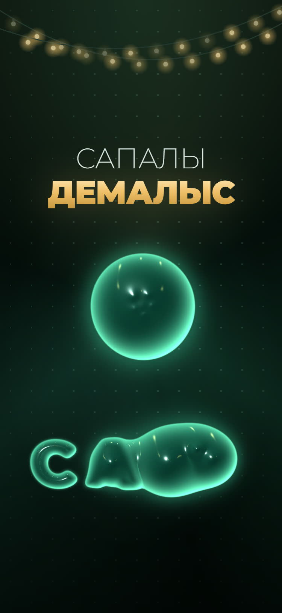
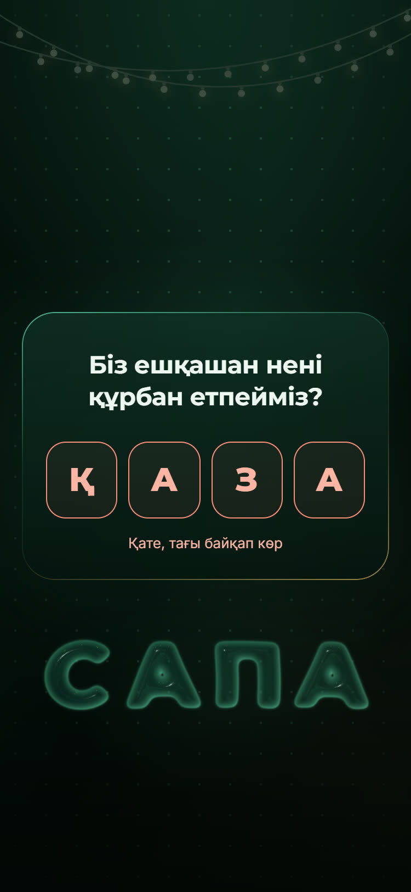
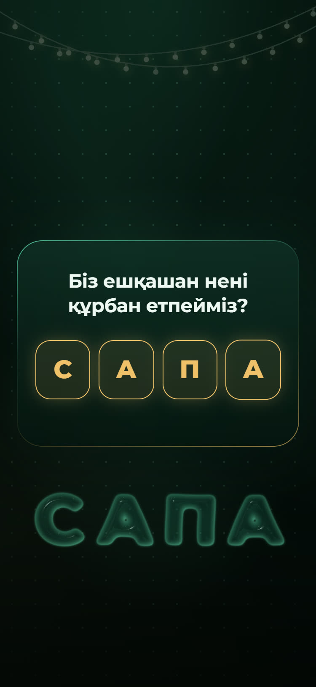
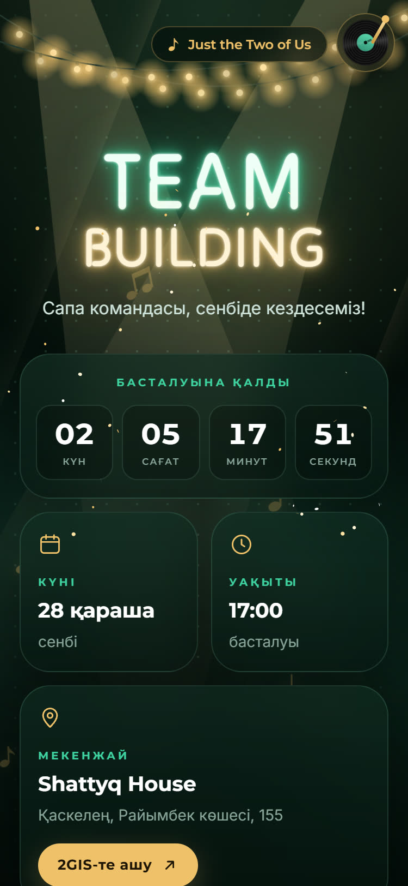
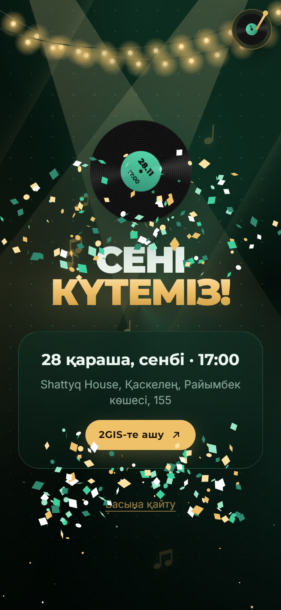

# Сапа · Тимбилдинг 28.11 — дизайн-бриф

Бриф для доработки визуала в Claude Design. Описывает текущую версию сайта-приглашения:
экраны, тексты, токены, компоненты, анимации и технические ограничения, которые нужно
сохранить, чтобы новый дизайн можно было перенести обратно в код.

- Живая версия: https://dan1eloff.github.io/sapa-teambuilding/
- Скриншоты текущего дизайна: `docs/screens/*.jpg` (375×812, ретина)

---

## 1. Контекст

| | |
|---|---|
| Что | Интерактивное приглашение отдела **Сапа** на тимбилдинг |
| Кто открывает | Сотрудники отдела (Сапа — отдел контроля качества в JUZ40) |
| Где | **Телефон, встроенный браузер Telegram** (iOS и Android). ПК — редко |
| Экран | 360–430 px по ширине, вертикально. Только тёмная тема |
| Язык интерфейса | **Казахский** (подписи в брифе — с переводом на русский) |
| Событие | Сб, 28.11.2026, 17:00 · Shattyq House, Қаскелең, Райымбек көшесі, 155 · дресс-код «Еркін стиль» |
| Настроение | Тёплый вечер за городом, джаз-клуб, гирлянды, качество («сапа» = «качество») |
| Музыка | «Just the Two of Us» (Grover Washington Jr.), включается после кода |

Чего пользователь **не хочет** (уже убрано): надписи-лейблы вроде «SAPA TEAM» над заголовком
(выглядят «как сделал ИИ»), плашки вроде «ШАҚЫРУ АШЫЛДЫ», текстовые подсказки «нажми 4 раза»,
иконка замка в окне кода, ромб как кнопка, летающие по фону буквы.

---

## 2. Флоу и экраны

### Экран 1. Вход: жидкая сфера
 

- Заголовок: **САПАЛЫ** (тонкий, 200) / **ДЕМАЛЫС** (900, золотой градиент) — игра слов «качественный отдых».
- По центру изумрудная **жидкая гель-сфера** (WebGL). Поверхность живая, сама слегка пульсирует, как будто зовёт нажать.
- Каждый тап: сфера вздрагивает → отрывается капля → капля стекает вниз к своему месту → **перетекает в букву**.
  За 4 тапа получается слово **С А П А** из того же геля. Сфера каждый раз теряет немного объёма, после 4-й буквы растворяется.
- Никаких подсказок, индикаторов и лейблов: подсказка — сама сфера.

### Экран 2. Код
  

- Стеклянная карточка **строго по центру экрана**, градиентная рамка (изумруд → золото).
- Вопрос: **«Біз ешқашан нені құрбан етпейміз?»** («Чем мы никогда не жертвуем?»). Ответ — САПА (качество).
- 4 ячейки, как для SMS-кода: активная светится и мигает курсором, буква «подпрыгивает» при вводе.
- Неверно: ячейки краснеют, карточка трясётся, «Қате, тағы байқап көр», через 0.75 с поле очищается.
- Верно: ячейки по очереди загораются золотом.
- Под карточкой остаётся гелевое слово САПА (прозрачность 40%), гирлянда гаснет — темнота перед «включением света».

### Экран 3. Джаз-клуб открывается (приглашение)
  

Сцена появляется «на глазах»:

| t | Что происходит |
|---|---|
| 0.00 | Экран кода растворяется, остаётся тёмный фон |
| 0.25 | Щелчок рубильника, стартует музыка (нарастание 3 с), лампочки гирлянды загораются слева направо, по 38 мс на каждую, с мерцанием |
| 0.90 | Плавно включаются два тёплых прожектора и медленно покачиваются |
| 1.70 | Неоновая вывеска **TEAM** загорается с мерцанием (мятный неон) |
| 2.15 | Загорается **BUILDING** (тёплый золотой неон) с искрами |
| 2.50 | Подзаголовок, отсчёт, карточки поднимаются снизу; начинают всплывать золотые ноты |
| 2.90 | Справа сверху появляется виниловая пластинка-плеер, рядом на 5 с плашка «♪ Just the Two of Us» |

Дальше постоянно: лампочки, прожекторы и свечение пульсируют **в ритм баса** трека (анализ звука в реальном времени).
Неон иногда «моргает», как настоящий.

Блоки страницы сверху вниз:
1. Неон **TEAM / BUILDING** + «Сапа командасы, сенбіде кездесеміз!» («Команда Сапа, встречаемся в субботу!»)
2. Отсчёт «БАСТАЛУЫНА ҚАЛДЫ» («До начала осталось»): КҮН · САҒАТ · МИНУТ · СЕКУНД
3. Карточки: КҮНІ (28 қараша, сенбі) · УАҚЫТЫ (17:00, басталуы) · МЕКЕНЖАЙ (Shattyq House + адрес + кнопка «2GIS-те ашу») · ДРЕСС-КОД (Еркін стиль, «Өзіңе ыңғайлы киін» — «одевайся как удобно»)
4. Галерея «БІЗ ДЕМАЛАТЫН ОРЫН» («Где мы отдыхаем»): 8 фото 4:5, свайп, счётчик 01/08, точки
5. Кнопка **«ҚАТЫСУДЫ РАСТАУ»** («Подтвердить участие»), золотая обводка с бегущим бликом
6. Подвал «28 · 11 · 2026»

Пластинка = кнопка звука: тап → игла поднимается, пластинка останавливается, музыка затихает.

### Экран 4. Финал

- По «Подтвердить»: страница «влетает» в кнопку (scale ×4 + fade, 0.8 с), по центру слово «САПА» взрывается в размытие (1.3 с).
- Крутится большая пластинка с ярлыком «28.11 / 17:00», **СЕНІ КҮТЕМІЗ!** («Ждём тебя!»), карточка с датой и адресом, «2GIS-те ашу», конфетти.
- «Басына қайту» («Вернуться в начало») перезагружает страницу.

### Превью ссылки в Telegram (1200×630)

---

## 3. Дизайн-токены

### Цвета
| Токен | Значение | Где |
|---|---|---|
| `--bg` | `#040d0a` | фон (почти чёрный с зеленью) |
| `--em-deep` | `#276E5A` | фирменный зелёный Сапа (фон логотипа) |
| `--em` | `#2F8970` | фирменный зелёный Сапа (ромб логотипа) |
| `--em-glow` | `#3fd1a0` | свечение, лейблы, активные состояния |
| `--mint` | `#9be7c8` | точки сетки, мелкие акценты |
| `--gold` | `#f0c06a` | лампочки, кнопки, иконки |
| `--gold-hi` | `#ffe2a3` | сердцевина лампочек, блики |
| `--gold-deep` | `#c9973f` | низ золотого градиента |
| `--ink` | `#eef7f3` | основной текст |
| `--muted` | `#8aa69c` | вторичный текст |
| ошибка | `#ff8f7a` / `#ffb4a5` | рамка / текст |

Золотой текст: `linear-gradient(180deg, #ffeabb 0%, #f0c06a 48%, #c9973f 100%)`.
Гель сферы: глубокий `rgb(5,51,40)` → средний `rgb(31,133,103)` → светлый край `rgb(107,237,187)`, белый блик, тёплые отражения лампочек.

### Шрифты
| Роль | Шрифт | Важно |
|---|---|---|
| Заголовки, цифры, лейблы | **Montserrat** 200–900 | Должен поддерживать казахские буквы Ә Ғ Қ Ң Ө Ұ Ү Һ І. Unbounded и Manrope **не подходят**: в них этих букв нет |
| Неоновая вывеска | **Tilt Neon** | Только латиница (TEAM BUILDING). Для казахского текста не использовать |
| Текст | **Inter** 400–700 | |

Лейблы: Montserrat 700, 10 px, разрядка 0.24em, `--em-glow`.

### Формы и поверхности
- Радиусы: карточки 28 px, окно кода 30 px, ячейки 18 px, фото 22 px, кнопки — пилюли.
- Стеклянная карточка: `linear-gradient(180deg, rgba(16,44,35,.66), rgba(7,22,17,.66))`, рамка `rgba(155,231,200,.14)`, `backdrop-filter: blur(18px)`, тень `0 18px 50px rgba(0,0,0,.35)`.
- Фон: радиальный градиент сверху, медленно вращающееся conic-свечение (22 с), сетка точек 28 px с затуханием к краям, виньетка снизу.

---

## 4. Компоненты и их параметры

| Компонент | Как сделан | Что можно менять в дизайне |
|---|---|---|
| Жидкая сфера | WebGL-шейдер, метаболы: 1 главный шар + 5 «спутников» на пружинах; капля = голова + хвост; буквы — размытая маска Montserrat 900 | цвет и материал геля, размер, блики, отражения, путь капли, место слова |
| Буквы САПА | тот же гель, лежат в 4 слотах под сферой | размер, расположение (под/над сферой), цвет после формирования |
| Ячейки кода | скрытый input + 4 «ячейки» | форма, размер, состояния |
| Гирлянда | SVG, 2 провода с провисом, ~24 лампочки | плотность, форма лампочек, где висит |
| Неон | текст + многослойный `text-shadow`, мерцание `steps()` | шрифт, цвета, рамка-трубка вокруг, доп. слово |
| Прожекторы | 2 размытых трапеции, `mix-blend-mode: screen` | количество, цвет, движение |
| Пластинка-плеер | CSS-винил 54 px + тонарм | вид, расположение |
| Ноты | 3 SVG-формы, всплывают 10–16 с, прозрачность ≤ 0.4 | формы, частота |
| Карточки инфо | сетка 2 колонки, иконки линейные 22 px золотые | компоновка, иерархия, иконки |
| Галерея | горизонтальный scroll-snap, карточка 78% ширины, 4:5 | подача фото, подписи |
| CTA | пилюля с золотой обводкой и бликом | стиль, текст |

---

## 5. Тексты (KZ → RU)

| Где | Казахский | Перевод |
|---|---|---|
| Вход | САПАЛЫ ДЕМАЛЫС | Качественный отдых |
| Вопрос | Біз ешқашан нені құрбан етпейміз? | Чем мы никогда не жертвуем? |
| Ошибка | Қате, тағы байқап көр | Неверно, попробуй ещё |
| Подзаголовок | Сапа командасы, сенбіде кездесеміз! | Команда Сапа, встречаемся в субботу! |
| Отсчёт | БАСТАЛУЫНА ҚАЛДЫ · КҮН · САҒАТ · МИНУТ · СЕКУНД | До начала осталось · дн · ч · мин · сек |
| После старта | Тимбилдинг басталды! 🎉 / Керемет өтті! Рақмет! 💚 | Тимбилдинг начался! / Было круто! Спасибо! |
| Карточки | КҮНІ · УАҚЫТЫ · МЕКЕНЖАЙ · ДРЕСС-КОД | Дата · Время · Адрес · Дресс-код |
| | 28 қараша, сенбі · 17:00, басталуы | 28 ноября, суббота · 17:00, начало |
| | Еркін стиль · Өзіңе ыңғайлы киін | Свободный стиль · Одевайся как удобно |
| Кнопки | 2GIS-те ашу · ҚАТЫСУДЫ РАСТАУ · Басына қайту | Открыть в 2GIS · Подтвердить участие · В начало |
| Галерея | БІЗ ДЕМАЛАТЫН ОРЫН; Вилла, Ашық алаң, 50 адамдық зал, Демалыс бөлмесі, Бильярд пен теннис, Қонақ залы, Ас үй, Жатын бөлме | Где мы отдыхаем; вилла, открытая площадка, зал на 50 человек, комната отдыха, бильярд и теннис, гостиная, кухня, спальня |
| Финал | СЕНІ КҮТЕМІЗ! | Ждём тебя! |

---

## 6. Звук

Трек 0:00–4:00 по кругу, громкость 90%, нарастание 3 с. Звуки синтезируются в браузере:
«буль» капли при тапе, ноты До-Ми-Соль-До при появлении букв, арпеджио при верном коде,
низкий «бзз» при ошибке, щелчок рубильника перед светом, «вжух» при подтверждении.

---

## 7. Ограничения — сохранить при редизайне

1. **Без сборки и фреймворков**: один `index.html`, `css/style.css`, `js/*.js`. Хостинг — GitHub Pages.
2. **Казахские буквы** во всех шрифтах кириллического текста (см. раздел 3).
3. **Звук только после тапа** (правило iOS): первый тап по сфере «разблокирует» аудио.
4. **Ввод**: шрифт поля ≥ 16 px, иначе iOS приближает экран.
5. **Высота**: `100dvh`, отступы `safe-area`; окно кода по центру и при открытой клавиатуре.
6. **WebGL может не быть**: есть запасной вариант (CSS-сфера, буквы текстом). Новый дизайн сферы тоже должен иметь простой fallback.
7. **Производительность**: старые Android в Telegram. Без тяжёлых blur на больших анимированных слоях, анимации на `transform`/`opacity`.
8. **Reduced motion**: при «уменьшить движение» вращения и мерцания отключаются.
9. **Превью Telegram**: `assets/og.jpg` 1200×630, рендерится из `tools/og.html`.

---

## 8. Что можно улучшить в Claude Design

- Экран входа: композиция заголовка и сферы, материал геля, где появляется слово.
- Окно кода: подача вопроса, вид ячеек, анимация успеха.
- Приглашение: иерархия после неона, вид карточек (сейчас одинаковые стеклянные), подача галереи.
- Финал: пластинка, заголовок, что ещё показать (например, «что взять с собой»).
- Превью в Telegram: обновить под новую стилистику (неон, сфера).

## 9. Где что в коде

| Что | Файл |
|---|---|
| Тексты, дата, адрес, код, фото, музыка | `js/config.js` |
| Разметка экранов | `index.html` |
| Стили и токены | `css/style.css` (`:root`) |
| Жидкая сфера (шейдер, физика) | `js/liquid.js` |
| Флоу, гирлянда, неон, ноты, отсчёт, галерея | `js/app.js` |
| Звук и ритм | `js/audio.js` |
| Конфетти/искры | `js/confetti.js` |
